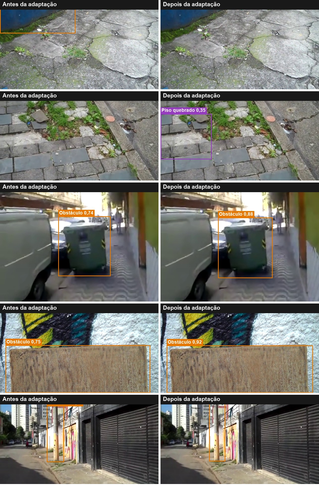

# Calçada Livre · Visão Computacional

**FIAP · Global Solution 2026.2 · Engenharia de Software (4ES) · Applied Computer Vision**
Atividade *“Enxergando o mundo real”* · Prof. Arnaldo Viana e Prof. Paulo Rodrigues

| Integrante | RM |
|---|---|
| Carlos Ganzerli | 99840 |
| Paulo Lopes | 551137 |
| Lucas Bandeira | 98640 |
| Gustavo Melo | 98809 |

Detector de objetos **em tempo real**, treinado de forma customizada (YOLO26n), que encontra
**buracos**, **obstáculos** e **piso quebrado** em fotos e vídeos de calçadas e transforma cada
barreira em uma **ocorrência** no mapa do MVP Calçada Livre.

📄 **Relatório (ABNT):** [PDF](docs/Relatorio_Visao_Computacional_Calcada_Livre.pdf) · [DOCX editável](docs/Relatorio_Visao_Computacional_Calcada_Livre.docx)
🎬 **Vídeo de demonstração:** <https://www.youtube.com/watch?v=oh_gcKEkcOc>
📓 **Notebook com as saídas:** [`notebooks/visao_calcada_livre.ipynb`](notebooks/visao_calcada_livre.ipynb)
🎥 **Como gravar a demonstração ao vivo:** [`docs/DEMO_AO_VIVO_CELULAR.md`](docs/DEMO_AO_VIVO_CELULAR.md)

---

## Ficha Técnica do MVP

| Campo | Calçada Livre |
|---|---|
| **Nome** | Calçada Livre: mapa colaborativo de barreiras nas calçadas |
| **Cidadão e território** | Pessoas com deficiência, idosos e quem circula com carrinho de bebê; piloto em São Paulo (SP) |
| **Problema, em uma frase** | Pessoas com mobilidade reduzida deixam de sair de casa ou se machucam porque não sabem quais calçadas têm barreiras, e a prefeitura não tem um mapa atualizado delas. |
| **Proposta de valor** | O cidadão reporta a barreira com uma foto; a visão computacional identifica o tipo, a ocorrência entra no mapa e segue para triagem e zeladoria. |
| **Componentes** | Carrinho inspetor (Maker Lab) · **Visão computacional (este repositório)** · Assistente LLM + RAG (GenAI) · Triagem (RPA) · Pipeline de dados (Big Data) · Deploy seguro (DevOps) · Pitch (BI) |
| **Fontes de dados** | Datasets públicos MIT de obstáculos e buracos; vídeos de calçadas de SP (Wikimedia Commons, CC BY 3.0); SP156, Open-Meteo e IBGE (Big Data) |
| **Modelos de IA** | YOLO26n customizado (3 classes) + ByteTrack; LLM local com RAG/LoRA (assistente) |
| **URL e repositório** | <https://github.com/paulopes1/calcada-livre> |
| **Indicadores de impacto** | Barreiras mapeadas, % resolvidas, dias até a resolução, km de rota acessível |
| **ODS** | 11 (metas 11.2 e 11.7), 10 e 3 |

---

## Resultados

Modelo final: **YOLO26n** (2,5 milhões de parâmetros, 5,5 MB), treinado por transfer learning em um dataset próprio de **7.499 imagens** e adaptado a calçadas brasileiras.

**Teste original** (imagens nunca vistas no treino):

| Classe | Precisão | Revocação | mAP50 | mAP50-95 |
|---|---|---|---|---|
| **Todas** | **0,890** | **0,814** | **0,852** | **0,604** |
| Buraco | 0,799 | 0,670 | 0,721 | 0,408 |
| Obstáculo | 0,931 | 0,911 | 0,953 | 0,809 |
| Piso quebrado | 0,941 | 0,862 | 0,881 | 0,594 |

**Teste brasileiro** (quadros de vídeos reais da Bela Vista, SP, separados no tempo dos quadros de adaptação):

| | mAP50 geral | Obstáculo | Piso quebrado |
|---|---|---|---|
| Antes da adaptação | 0,386 | 0,729 | 0,044 |
| **Depois da adaptação** | **0,527** | **0,941** | **0,113** |

**Tempo real:** 61 FPS em GPU (NVIDIA GeForce RTX 5060) e 25 FPS só em CPU, ponta a ponta, uma imagem por vez.

Comparação de arquiteturas com a mesma receita (teste original): ver [`results/comparacao.md`](results/comparacao.md).

<p align="center">
  <br>
  <em>Teste brasileiro (quadros de vídeos da Bela Vista, SP, nunca usados no treino): antes × depois da adaptação de domínio.</em>
</p>

Mais figuras: matriz de confusão, curvas PR/F1 e exemplos de acerto e erro em [`results/calcada_yolo26n/`](results/calcada_yolo26n/).

---

## Como funciona

```
 foto do cidadão / vídeo / câmera
            │
            ▼
  ┌──────────────────────┐    EXIF removido, rostos e placas borrados (LGPD)
  │  pré-processamento   │
  └──────────┬───────────┘
             ▼
  ┌──────────────────────┐    YOLO26n customizado: buraco · obstáculo · piso quebrado
  │  detector (tempo real)│   + ByteTrack no vídeo (conta cada barreira uma vez)
  └──────────┬───────────┘
             ▼
  ┌──────────────────────┐    tipo, confiança, prioridade sugerida, protocolo
  │  POST /detectar      │──► confiança < 60% → "pendente_validacao" (humano no circuito)
  └──────────┬───────────┘
             ▼
   ocorrência (contrato único do MVP) ──► mapa · RPA (triagem) · Big Data · assistente
```

### Pipeline de treino (scripts numerados, semente fixa 42)

| Etapa | Script | O que faz |
|---|---|---|
| 1 | `scripts/01_download_datasets.py` | Baixa os datasets públicos (sem conta), só as imagens úteis |
| 2 | `scripts/02_build_dataset.py` | Remapeia para 3 classes, filtra qualidade, deduplica por pHash, divide 80/10/10 sem vazamento |
| 3 | `scripts/03_train.py` | Fine-tuning do YOLO (COCO → Calçada Livre) |
| 4 | `scripts/04_evaluate.py` | Métricas no teste, matriz de confusão, FPS em GPU/CPU, exemplos de acerto/erro |
| 5 | `scripts/05_video_demo.py` | Detecção + rastreamento em vídeo, webcam ou celular; envia ocorrências ao MVP |
| 6 | `scripts/06_download_videos_sp.py` | Vídeos reais de calçadas de SP (teste fora da distribuição) |
| 7 | `scripts/07_make_samples.py` | Amostras para os testes automatizados |
| 8 | `scripts/08_build_notebook.py` | Gera e executa o notebook de análise (com saídas salvas) |
| 9–10 | `scripts/09_figures.py`, `scripts/10_report.py`, `scripts/10b_report_docx.py` | Figuras e relatório em PDF e DOCX, no padrão ABNT (números lidos de `results/`) |
| 11 | `scripts/11_extract_frames_sp.py` | Extrai quadros dos vídeos de SP com divisão **temporal** (início = adaptação, final = teste brasileiro) |
| 12 | `scripts/12_annotation_sheets.py` | Folhas de anotação assistida (grade de coordenadas + sugestões do modelo) |
| 13 | `scripts/13_domain_adaptation.py` | Adaptação de domínio para calçadas brasileiras e comparação antes × depois |

### Adaptação para calçadas brasileiras

O teste em vídeos reais da Bela Vista (SP) mostrou que o modelo treinado só com datasets estrangeiros quase não
reconhecia o piso quebrado típico do Brasil. Anotamos quadros desses vídeos (`configs/anotacoes_sp.json`), fizemos um
fine-tuning curto e avaliamos em trechos finais dos vídeos, separados no tempo e nunca usados no treino. O modelo
adaptado só substitui o anterior se melhorar no teste brasileiro sem perder mais de 2 pontos de mAP50 no teste original.

---

## Como rodar

Todos os comandos abaixo são executados de dentro desta pasta (`visao/`).

```bash
git clone https://github.com/paulopes1/calcada-livre.git
cd calcada-livre/visao
```

### 1. Ambiente

Requisitos: Python 3.12, (opcional) GPU NVIDIA, FFmpeg para gerar vídeos.

```bash
python -m venv .venv
.venv\Scripts\activate            # Windows  (Linux/macOS: source .venv/bin/activate)
pip install torch torchvision --index-url https://download.pytorch.org/whl/cu128   # GPU NVIDIA
# sem GPU:  pip install torch torchvision
pip install -r requirements.txt
```

### 2. Só usar o modelo treinado (já incluso em `models/`)

```bash
uvicorn api.main:app --host 0.0.0.0 --port 8000
```

Abra <http://127.0.0.1:8000> para reportar uma barreira por **foto ou vídeo**, ou <http://127.0.0.1:8000/docs> para a documentação da API.

Ao escolher um **vídeo** no passo 1, a página o envia e abre uma janela com a **análise ao vivo**: cada quadro
aparece com as caixas e o ID de rastreamento, os contadores sobem em tempo real e cada barreira confirmada
(rastreada por 4 quadros, confiança ≥ 50%) vira uma ocorrência no mapa na mesma hora. O vídeo original é apagado
ao fim da análise.

Para começar uma demonstração com o mapa vazio: `python scripts/limpar_ocorrencias.py` (pode rodar com a API no ar).

```bash
curl -F "foto=@samples/buraco_1.jpg" -F "latitude=-23.5614" -F "longitude=-46.6559" http://127.0.0.1:8000/detectar
```

Detecção em tempo real pela linha de comando (janela do OpenCV):

```bash
python scripts/05_video_demo.py --source 0 --show                          # webcam
python scripts/05_video_demo.py --source http://IP-DO-CELULAR:8080/video --show --api http://127.0.0.1:8000
python scripts/05_video_demo.py --source meu_video.mp4 --out saida.mp4
```

> Para usar a câmera do celular, instale um app de câmera IP (ex.: *IP Webcam* no Android), conecte o celular
> na mesma rede Wi-Fi e use a URL que o app mostrar.

### 3. Reproduzir o treino do zero

```bash
set CALCADA_DATA=D:\dados\calcada      # opcional: onde guardar os datasets (padrão: ./data)
python scripts/01_download_datasets.py
python scripts/02_build_dataset.py
python scripts/03_train.py --model yolo26n.pt
copy models\yolo26n_calcada_best.pt models\calcada_yolo26n.pt
python scripts/06_download_videos_sp.py
python scripts/11_extract_frames_sp.py
python scripts/13_domain_adaptation.py          # usa as anotações de configs/anotacoes_sp.json
python scripts/04_evaluate.py models/calcada_yolo26n.pt models/calcada_yolo26n_base.pt
```

### 4. Testes automatizados

```bash
pytest -q
```

Cobrem: saúde da API, uma ocorrência por classe com o tipo correto, endereço salvo e corrigido, foto sem barreira,
arquivo inválido, coordenada inválida, **remoção do EXIF/GPS**, validação humana (PATCH) com filtros e GeoJSON,
limpeza do banco com a API no ar, **vídeo enviado pelo site** (transmissão ao vivo, ocorrências criadas e vídeo apagado)
e **formato de envio ao MVP do grupo** (regras da triagem e replicação em segundo plano).

---

## API (contrato da ocorrência)

| Método | Rota | Descrição |
|---|---|---|
| `POST` | `/detectar` | Foto (multipart) + `latitude`, `longitude`, `endereco`, `descricao`, `origem` opcionais → cria a ocorrência |
| `GET` | `/ocorrencias` | Lista (filtros `tipo`, `status`) |
| `GET` | `/ocorrencias.geojson` | Ocorrências georreferenciadas para mapas e para o Big Data |
| `GET` | `/ocorrencias/{id}` | Detalhe |
| `PATCH` | `/ocorrencias/{id}` | Validação humana: `status`, correção de `tipo`, `prioridade`, `endereco` e coordenadas |
| `GET` | `/ocorrencias/{id}/foto` | Foto anotada (sem EXIF, rostos borrados) |
| `POST` | `/videos` | Vídeo MP4/WEBM/MOV até 200 MB (multipart) + `latitude`, `longitude`, `endereco` opcionais → devolve o `id` da análise |
| `GET` | `/videos/{id}/ao-vivo` | Transmissão MJPEG da análise (quadros anotados); cada barreira confirmada vira ocorrência com `origem: "video"` |
| `GET` | `/videos/{id}` | Andamento: `status`, progresso, FPS, contagem por classe e ocorrências criadas |
| `GET` | `/saude` | Estado do serviço e do modelo |

```json
{
  "id": 1, "protocolo": "CL-20261116-A1B2C3", "origem": "app",
  "tipo": "buraco", "confianca": 0.87, "prioridade": "alta", "status": "aberta",
  "latitude": -23.5614, "longitude": -46.6559, "endereco": "Rua Rocha, 206 - Bela Vista - São Paulo", "descricao": null,
  "deteccoes": [{"classe": "buraco", "rotulo": "Buraco", "confianca": 0.87, "bbox": [412.0, 380.5, 690.2, 560.0]}],
  "foto_url": "/ocorrencias/1/foto", "modelo": "calcada_yolo26n.pt",
  "criado_em": "2026-11-16T19:00:00+00:00", "atualizado_em": "2026-11-16T19:00:00+00:00"
}
```

Variáveis de ambiente: `MODEL_PATH`, `CONF_MIN` (0,35), `CONF_REVIEW` (0,60), `DB_PATH`, `PHOTOS_DIR`, `VIDEOS_DIR`,
`MVP_API_URL` e `VISAO_URL_PUBLICA` (ver abaixo).

### Integração com o MVP do grupo

A visão é uma das fontes do [MVP Calçada Livre](https://github.com/CarlosGanzerli/calcada-livre). Com `MVP_API_URL`
definida, cada ocorrência registrada aqui (foto ou vídeo) é replicada em `POST /api/ocorrencias` do MVP, em segundo
plano (não atrasa a resposta nem o vídeo ao vivo; se o MVP estiver fora do ar, o registro local continua valendo):

```json
{
  "tipo": "buraco", "latitude": -23.5614, "longitude": -46.6559, "origem": "visao", "confianca": 0.87,
  "foto_url": "https://<VISAO_URL_PUBLICA>/ocorrencias/12/foto",
  "descricao": "Buraco detectado por visão computacional (calcada_yolo26n.pt, 87% de confiança). Protocolo da visão: CL-20261117-A1B2C3. Endereço: Rua Rocha, 206."
}
```

O envio segue as mesmas regras da automação de triagem (RPA) do grupo, para a detecção não cair em quarentena:
coordenada dentro de São Paulo, tipo da lista do MVP (*piso quebrado* vai como `outro`, com o nome na descrição),
link absoluto da foto anotada (rostos e placas já borrados) e **confiança ≥ 0,5**. Ocorrências sem localização ou
abaixo de 0,5 ficam só no painel da zeladoria da visão. O módulo é [`api/integracao_mvp.py`](api/integracao_mvp.py)
e foi testado contra o MVP rodando localmente: as 13 ocorrências de uma demonstração (3 fotos + 1 vídeo) chegaram
com origem `visao` e passaram na regra de validação do robô.

```bash
set MVP_API_URL=https://endereco-do-mvp
set VISAO_URL_PUBLICA=http://127.0.0.1:8000
uvicorn api.main:app --port 8000
```

---

## Responsabilidade, LGPD e acessibilidade

- **Sem dados pessoais:** não guardamos nome, e-mail, telefone nem IP de quem reporta.
- **EXIF removido:** a foto é re-codificada a partir dos pixels, apagando GPS e modelo do aparelho (há teste automatizado para isso).
- **Rostos e placas borrados** antes de gravar a foto ou o vídeo.
- **Vídeo não é guardado:** o arquivo enviado pelo site é apagado assim que a análise termina (ou é interrompida); ficam só os quadros anotados das ocorrências.
- **Humano no circuito:** abaixo de 60% de confiança a ocorrência fica pendente; na própria página, o painel da zeladoria tem os botões *Confirmar* e *Rejeitar* (PATCH `/ocorrencias/{id}`).
- **Acessível:** contraste alto, tema escuro automático, navegação por teclado, link “pular para o conteúdo”, mensagens com `aria-live` e tabela equivalente ao mapa para leitores de tela.
- **Local da barreira de três formas:** endereço digitado (busca no OpenStreetMap), clique no mapa com marcador arrastável ou GPS do aparelho.
- **Pouca conectividade:** a foto é reduzida no próprio celular antes do envio; o mapa degrada para a tabela se o Leaflet não carregar.

## Limitações conhecidas

- **Piso quebrado** é a classe com menos dados e fronteira mais subjetiva; é a de menor desempenho.
- Os datasets públicos vêm majoritariamente de outros países. A adaptação com quadros de São Paulo reduziu a diferença, mas usou 8 vídeos de um mesmo bairro e um único anotador; o teste brasileiro é pequeno e suas métricas têm variância maior. A validação humana do MVP produz os dados para ampliar essa base.
- O borrão de rostos/placas usa classificadores Haar (leves, mas não infalíveis).

## Estrutura

```
api/            FastAPI (/detectar, /videos), detector, análise de vídeo ao vivo, banco SQLite e página web acessível
configs/        taxonomia das 3 classes, mapeamento das classes de origem e anotações dos quadros de SP
docs/           relatório em PDF (ABNT), guia de gravação da demonstração e créditos/licenças
models/         pesos treinados (calcada_yolo26n.pt = modelo final do MVP; _base = antes da adaptação)
notebooks/      notebook de análise executado (com saídas)
results/        métricas, matriz de confusão, curvas, exemplos e figuras
samples/        imagens de exemplo do conjunto de teste
scripts/        pipeline completo, numerado na ordem de execução
tests/          testes automatizados da API
```

## Créditos e licenças

Datasets e vídeos de terceiros com licenças MIT e CC BY 3.0: ver [`docs/CREDITOS.md`](docs/CREDITOS.md).
Este código usa o Ultralytics YOLO (AGPL-3.0) e por isso é distribuído sob a mesma licença.
